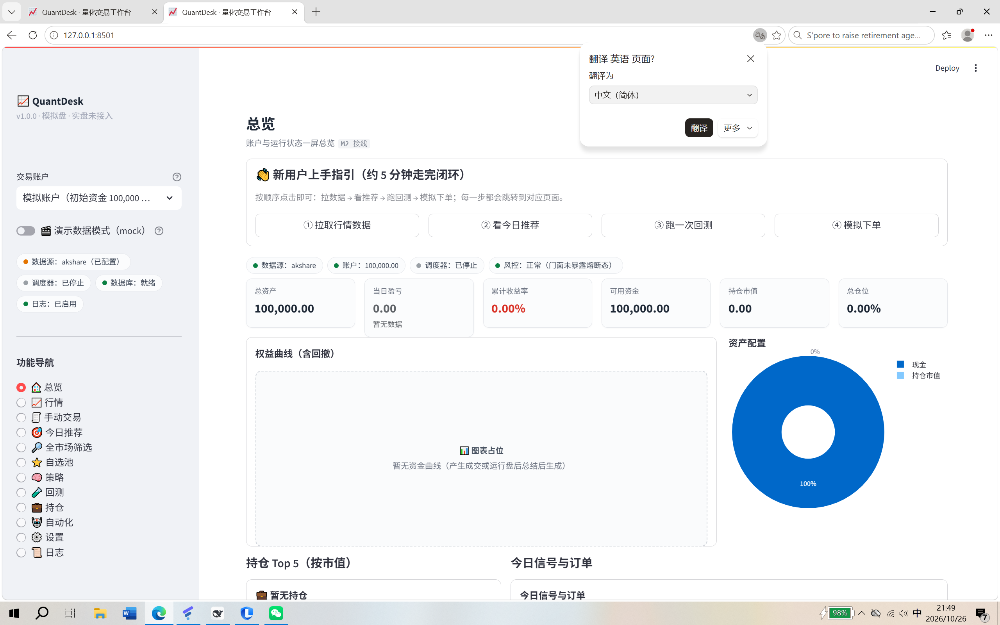

# QuantDesk 量化交易工作台


> 本地运行 · 单用户 · 日频为主 · 个人研究用途
> 当前阶段：**v2.0.1 补丁发布（2026-10-27）**——v2.0.0 正式版（MVP M0–M5 + Phase 2 M6 研究阶段）已于同日发布；M6 结论为负结果（**无可执行短线选股边际**），见 §4.1。最后更新：2026-10-27 · 文档版本 v2.0.1（变更记录见 §8；补丁说明见 [docs/RELEASE_NOTES_v2.0.1.md](docs/RELEASE_NOTES_v2.0.1.md)）

---

## 1. 项目简介

**一句话**：QuantDesk 是一个把「数据获取 → 策略信号 → 风控闸门 → 回测 → 模拟盘/实盘执行 → 定时自动化 → 可视化与通知」收进同一个本地界面的量化交易工作台。

**三句话**：

1. 行情与基本面数据通过 akshare 自动拉取并缓存到本地 SQLite，断网时自动降级到本地缓存与内置 Mock 数据，全流程仍可演示。
2. 所有交易意图先由策略产出信号，再经过**唯一的风控闸门**裁决，通过后才进入回测撮合、模拟盘或券商适配层，手动下单与自动下单走同一条链路。
3. 界面全中文，关键的自动动作都有结构化日志、审计流水与 `trace_id` 可追溯，可随时一键停止。

> 本系统仅供个人研究学习，**不构成投资建议**；回测收益不代表未来表现；A 股数据来自公开接口，可能存在缺失或延迟。

---

## 界面预览



> 侧边栏 12 个页面：总览 / 行情 / 手动交易 / 今日推荐 / 全市场筛选 / 自选池 / 策略 / 回测 / 持仓 / 自动化 / 设置 / 日志

---

## 2. 快速开始（一键启动）

### 2.1 三分钟上手

> 最小路径：**先确认环境 → 再启动 → 看页面**。遇到任何报错，先跳到 [docs/RUNBOOK.md](docs/RUNBOOK.md) 的排障表按现象查。

**第 1 步 · 确认环境（约 30 秒）**

```bat
cd /d <你的路径>\quantdesk
.venv\Scripts\python.exe scripts\check_env.py
```

→ **期望**：打印 Python 版本与每个关键依赖的版本；核心依赖齐备时**退出码为 0**，末尾给出缺失清单与可复制的安装命令。
→ 若提示缺包或 Python 版本不符，按 [docs/RUNBOOK.md §1](docs/RUNBOOK.md) 准备环境（含国内镜像与版本锁定）。

**第 2 步 · 双击启动（约 10 秒）**

打开 `quantdesk\scripts` 目录，**双击 `start.bat`**。脚本会：
- 优先使用项目内 `.venv`（回退 `D:\Anaconda3\python.exe`，再回退 PATH 中的 `python`）；
- 自动检查端口 **8501**：被占用时**自动改用 8502~8510** 的空闲端口，并在窗口打印实际访问地址（以窗口输出的 `http://localhost:<端口>` 为准）；
- 把启动输出同时写入 `runtime\logs\start.log`；窗口保持显示启动信息与运行输出。

→ **首次运行**：应用启动时自动创建/校验 SQLite 数据库与表；首次在「行情」页或「设置 → 数据源」点击「刷新数据」（或运行 `.venv\Scripts\python.exe scripts\fetch_data.py`）会拉取 `config.yaml` 中 `data.universe` 的 **3 只示例标的**（`600519.SH` / `000001.SZ` / `300750.SZ`）；akshare 不可用时自动降级 Mock 离线数据，全流程仍可演示。
→ **停止**：双击 `scripts\stop.bat`（按端口找到进程并中文确认后结束），或直接关闭启动窗口 / 按 `Ctrl+C`。
→ 使用期间保持该窗口打开；页面说明：`app.py` 已交付（M0-07），**12 个导航项**由「页面动态发现」自动生成（每个 `ui/pages/*.py` 即一页）：总览 / 行情 / 手动交易 / 策略 / 回测 / 持仓 / 自动化 / 设置 / 日志 / 自选池 / 今日推荐 / **全市场筛选**；各页功能深度不同，未接线的区块会显示「建设中」或「接口待接入」提示，**属设计内空白**（逐页状态见 `docs/DOC_INDEX.md` §3.5）。
→ 若提示「未找到 app.py」：说明文件缺失或不在项目根目录，按 [docs/RUNBOOK.md §4](docs/RUNBOOK.md) 第 6 行处理（已不再是"阶段正常"）。

**第 3 步 · 看进度与下一里程碑（约 1 分钟）**

- 当前做到哪一步、每个阶段你能验证什么 → [docs/ROADMAP.md](docs/ROADMAP.md)（§2 M0 起，每个里程碑都有「用户视角验收演示脚本」，照着点一遍即可）
- 术语看不懂（T+1、涨跌停、夏普、回撤…）→ [docs/GLOSSARY.md](docs/GLOSSARY.md)
- 想按清单逐项验收 → [docs/ACCEPTANCE_CHECKLIST.md](docs/ACCEPTANCE_CHECKLIST.md)

> 交付后的最终形态：**不写一行代码**完成 4 个核心任务——① 行情页看一只票 K 线；② 回测页跑出绩效报告；③ 手动交易页买入 100 股；④ 自动化页开启定时任务并在日志页看到记录（AC-F7-02 / G2）。

### 2.2 前置条件

| 项目 | 要求 | 本机验证环境 |
|---|---|---|
| 操作系统 | Windows 10 / 11（64 位） | Windows 10 AMD64 |
| Python | 3.10 及以上 | 3.12.7（Anaconda 打包版） |
| 依赖 | 见 `requirements.txt`，实测版本基线见 [docs/RUNBOOK.md 附录 A](docs/RUNBOOK.md) | numpy 1.26.4 / pandas 2.2.2 / streamlit 1.37.1 / akshare 1.19.3 / TA-Lib 0.8.2 |
| 磁盘 | 建议预留 1 GB 以上（数据库 + 依赖） | — |

> 建议把项目放在**不含中文和空格**的路径下，可减少第三方库的路径兼容问题。
> 项目内虚拟环境为 `quantdesk\.venv`，所有命令请优先使用 `.venv\Scripts\python.exe`。

### 2.3 双击启动（推荐）

1. 打开 `quantdesk\scripts` 目录，**双击 `start.bat`**。
2. 脚本按以下顺序自动选择解释器：
   - 优先：`quantdesk\.venv\Scripts\python.exe`
   - 回退：`D:\Anaconda3\python.exe`
   - 再回退：PATH 中的 `python`
3. **端口**：默认 `8501`；若已被占用，脚本自动改用 `8502~8510` 中第一个空闲端口，并在窗口提示实际访问地址（以窗口输出为准）。
4. 启动输出同时写入 `runtime\logs\start.log`（UTF-8），窗口保持显示启动信息与运行输出；启动成功后按窗口提示打开浏览器。
5. 使用期间**保持命令行窗口打开**；停止用 `scripts\stop.bat` 或关闭窗口 / `Ctrl+C`（见 §2.7）。

启动脚本内置的保护（避免“闪退”）：

- 找不到 `app.py` → 中文提示 + `pause`，窗口不会一闪而过；
- 找不到 Python 解释器 → 列出已检查的路径并给出创建 `.venv` 的命令；
- 缺少 `streamlit` → 给出安装命令（含国内镜像），而不是直接报错退出；
- 端口 8501 被占用 → 自动换 8502~8510（全部占用则中文提示）；也可用 `scripts\start.bat --port 8600` 指定端口；
- 启动失败 → 显示退出码、日志路径与排查建议（`scripts\check_env.py`、`scripts\stop.bat`），并保持窗口；
- 只想检查环境与端口而不启动：`scripts\start.bat --check`（打印将用的解释器/端口/日志路径后退出）。

> **页面说明**：`app.py`、`ui/pages/_common.py` 与 **12 个页面文件**均已交付（M0-07 起持续增加），因此**双击即可正常启动**，不再出现「未找到 app.py」。各页功能仍在推进，未接线的区块显示「建设中/接口待接入」，属正常（逐页状态见 `docs/DOC_INDEX.md` §3.5）。

### 2.4 首次环境准备

如果 `.venv` 尚未创建，在项目根目录（`quantdesk`）执行：

```bat
python -m venv .venv
.venv\Scripts\python.exe -m pip install -r requirements.txt
```

创建虚拟环境时使用的 `python` 需要是 3.10+；若系统没有，可先用 Anaconda：

```bat
D:\Anaconda3\python.exe -m venv .venv
```

> **两个已踩过的坑（务必先看）**：
> 1. 本机 pip 的**全局配置指向 NVIDIA 内部源**，直接装包会在 SSL 握手阶段卡死。请加 `--isolated` 忽略全局 pip 配置，并显式指定国内镜像：
>    ```bat
>    .venv\Scripts\python.exe -m pip install --isolated --index-url https://mirrors.aliyun.com/pypi/simple/ -r requirements.txt
>    ```
> 2. venv 是从 Anaconda 创建的（`include-system-site-packages = false`），但仍出现过与系统 numpy/pandas 版本不一致导致的导入报错。**请锁定 `numpy==1.26.4` + `pandas==2.2.2`**，这是本机实测可用的组合。
>
> 完整排障步骤见 [docs/RUNBOOK.md](docs/RUNBOOK.md) §1 与 §4。

### 2.5 环境自检

任何时候都可以运行环境自检脚本，确认依赖是否齐备：

```bat
.venv\Scripts\python.exe scripts\check_env.py
```

输出内容包括：Python 版本与路径、虚拟环境判断、每个关键依赖的版本、缺失清单，以及可直接复制的安装命令（含阿里云/清华镜像）。
退出码：全部核心依赖齐备为 `0`，有缺失为 `1`。

### 2.6 手动启动（排查问题时使用）

```bat
cd /d C:\Users\shanghao\Documents\deepseek-harness\default-workspace\quantdesk
.venv\Scripts\python.exe -m streamlit run app.py --server.headless true --browser.gatherUsageStats false
```

`--server.headless true` 表示不自动弹浏览器，请手动访问 <http://localhost:8501>。

### 2.7 停止服务（`stop.bat` / 关闭窗口）

停止正在运行的 QuantDesk 有三种等价方式：

1. **双击 `scripts\stop.bat`**（推荐）：自动查找 8501~8510 中运行中的实例；按端口定位监听进程、
   显示进程信息、**中文确认后**结束（同时释放端口）；若发现多个实例会列出端口并要求指定，避免误杀。
2. 直接**关闭启动窗口**或按 `Ctrl + C`。
3. 指定端口/跳过确认（自动化演练）：

```bat
scripts\stop.bat 8502        rem 停止 8502 端口上的实例
scripts\stop.bat 8502 /Y     rem 跳过确认（脚本/演练使用）
```

> 通过 `stop.bat` 强制结束进程时，启动窗口可能显示非 0 退出码并提示查看日志，这是
> “被外部停止”的正常现象；若未主动停止却出现该提示，再按 `docs/RUNBOOK.md` 排查。

---

## 3. 目录结构

> 标注「规划」的目录/文件属于 M0–M4 的交付目标，当前可能尚未创建；以仓库实际文件为准。
> **v2.0.0 新增文件**（M6 研究框架 / 报告 / QA 审计 / P1 被动基准 / 发布物料）的完整清单见 §4.1、§4.2 与 [docs/M6_INTEGRATION.md](docs/M6_INTEGRATION.md) §3。

```text
quantdesk/
├─ app.py                    # Streamlit 入口：页面动态发现 + 导航 + 异常兜底（M0-07，已交付）
├─ config.yaml               # 默认配置（键名冻结，见 docs/SPEC.md §7）
├─ requirements.txt          # 顶层依赖与版本区间（M0-01）
├─ BRIEF.md                  # 项目简报，团队唯一事实来源
├─ README.md                 # 本文件
├─ .venv/                    # 项目虚拟环境（不入库，不手工修改）
├─ core/                     # 基础设施（Dev1）
│  ├─ config.py              # 配置加载与 pydantic 校验（M0-02，已交付）
│  ├─ models.py              # pydantic 领域模型 + 22 张 ORM 表（M0-03，已交付）
│  ├─ db.py                  # 引擎/会话/建表/迁移/备份（M0-04，已交付）
│  ├─ events.py              # 事件总线（同步分发 + 异常隔离，M0-06，已交付）
│  └─ logging.py             # 结构化日志与审计（M0-05，已交付）
├─ data/                     # 数据层（Dev1）
│  ├─ provider.py            # DataProvider 抽象 + akshare / Mock（M1-01/02，已交付）
│  └─ cache.py               # 增量缓存、复权、数据质量校验（M1-03/04，已交付）
├─ strategy/                 # 策略层（Dev2）
│  ├─ base.py                # Strategy 基类、注册表、指标兼容层（M1-05/06，已交付）
│  └─ builtin/               # 双均线 / RSI 反转 / 多因子（M1-07/08/09，规划）
├─ backtest/                 # 回测层（Dev2）
│  ├─ engine.py              # 事件驱动回测引擎（M1-11，已交付）
│  ├─ broker_sim.py          # A 股撮合规则与费用模型（M1-10，唯一实现，已交付）
│  └─ metrics.py             # 收益/回撤/夏普/胜率等指标（M1-12，已交付）
├─ trading/                  # 交易执行层（Dev3）
│  ├─ broker.py              # BrokerAdapter 抽象 + 注册表（M2-01，已交付）
│  ├─ paper.py               # PaperBroker 模拟盘实现（M2-02，已交付）
│  ├─ order_manager.py       # 订单唯一入口 OrderService（M2-06/07，已交付）
│  ├─ risk.py                # 风控闸门 RiskGate（唯一入口，M2-04，已交付）
│  └─ portfolio.py           # 账户/持仓/资金曲线（M2-05，已交付）
├─ automation/               # 自动化（Dev3，规划）
│  ├─ scheduler.py           # APScheduler 封装（M3-01）
│  ├─ jobs.py                # 盘前 / 盘中 / 盘后任务（M3-02/03）
│  └─ notify.py              # 桌面 / 邮件 / Webhook 通知（M3-04）
├─ ui/pages/                 # 页面（每文件一页，共 12 页：总览/行情/手动交易/策略/回测/持仓/自动化/设置/日志/自选池/今日推荐/全市场筛选；未接线区块显示"建设中"）
├─ tests/                    # pytest 用例（conftest.py + test_models / test_risk / test_broker_sim 已交付，其余随任务补齐）
├─ scripts/
│  ├─ start.bat              # 一键启动（双击，GBK+CRLF）；自动选择空闲端口、输出写 runtime\logs\start.log
│  ├─ stop.bat               # 一键停止（按端口定位进程，中文确认后结束）
│  ├─ run_streamlit.py       # 启动包装器（控制台 + start.log 双输出，start.bat 调用）
│  ├─ check_env.py           # 环境自检
│  └─ init_db.py             # 初始化/迁移数据库（M0-09）
├─ docs/
│  ├─ DOC_INDEX.md           # 文档索引与阅读顺序（先读它）
│  ├─ SPEC.md                # 产品需求规格与验收标准（AC）
│  ├─ TASKS.md               # 任务分解与排期
│  ├─ ARCHITECTURE.md        # 系统架构与关键数据流
│  ├─ ROADMAP.md             # 里程碑与用户视角验收脚本
│  ├─ GLOSSARY.md            # 术语表（面向非程序员）
│  ├─ BORROW_MAP.md          # 借鉴来源与代码位置
│  ├─ borrow_map.json        # 借鉴来源机器可读清单（42 条）
│  ├─ THIRD_PARTY.md         # 第三方与许可登记
│  ├─ RUNBOOK.md             # 运维手册：环境/启动/排障
│  └─ ACCEPTANCE_CHECKLIST.md   # 验收清单（M0–M5 可勾选）
└─ runtime/                  # 运行期生成（不入库；已生成，含 quantdesk.db + WAL、logs/、backups/、exports/）
   ├─ quantdesk.db           # SQLite 主库
   ├─ logs/                  # JSON Lines 日志（按日轮转）
   ├─ backups/               # 每日数据库备份
   └─ exports/               # 回测/持仓导出文件
```

**目录约定**：`quantdesk/data/` 是 Python 包（数据层代码），数据库与日志统一放 `quantdesk/runtime/`，不要把 `.db` 文件放进 `data/`。

---

## 4. 当前进度

**总体：M0–M5 MVP 与 M6（Phase 2 策略研究）均已完成；v2.0.0 于 2026-10-27 发布，同日发布 v2.0.1 补丁（干净克隆测试健壮性）。** M6 结论为负结果：**无可执行短线选股边际**，不接入推荐/自动化，UI 维持「研究阶段」（见 §4.1 与 [docs/M6_RESEARCH_REPORT.md](docs/M6_RESEARCH_REPORT.md)）。

| 里程碑 | 状态 | 内容摘要 |
|---|---|---|
| **M0 骨架** | ✅ 已退出 | 依赖 + 目录 + 配置 + DB + 日志 + 空 UI 能启动 |
| **M1 研究闭环** | ✅ 功能通过（有效性未证明） | 数据层 + 回测 + 内置策略 → 跑出绩效报告；同仓位被动基准对照 |
| **M2 交易闭环** | ✅ 通过 | 模拟盘 + 手动下单 + 持仓/资金曲线 + 唯一风控闸门 |
| **M3 自动化** | ✅ 通过 | 定时任务 + 通知 + trace 链路；默认关闭 |
| **M4 交付** | ✅ 通过 | 一键启动/停止 + 全量测试 + RUNBOOK + 备份恢复 + 发版自检 |
| **M5 打磨** | 🟡 有条件通过 | 12 页 UI、报告导出、示例数据、USER_GUIDE/DEMO；设置/审计/策略实例仍有占位 |
| **M6 研究（Phase 2）** | ✅ 本轮完成（负结果） | 200 只 / 36 组 walk-forward OOS / QA 独立审计 PASS；**无可用配置**，见 §4.1 |

> 每个里程碑的**用户视角验收演示脚本**见 [docs/ROADMAP.md](docs/ROADMAP.md) §2.3 / §3.3 / §4.3 / §5.3 / §6.3 / §7.3；对应的可勾选清单见 [docs/ACCEPTANCE_CHECKLIST.md](docs/ACCEPTANCE_CHECKLIST.md)。

### 4.1 M6 研究成果（v2.0 新增）

> M6 是 Phase 2「策略研究增值」阶段，成果已并入主仓（`main` 基线 `b5c575a`）。完整实验见 [docs/M6_RESEARCH_REPORT.md](docs/M6_RESEARCH_REPORT.md)，独立审计见 [docs/M6_QA_AUDIT.md](docs/M6_QA_AUDIT.md)，并入清单与复现命令见 [docs/M6_INTEGRATION.md](docs/M6_INTEGRATION.md)。

**一句话结论：在日频免费数据上，3/5/10 日选股没有可执行的、统计上可信的边际。**

| 项 | 结果 |
|---|---|
| 数据 | 200 只 A 股 / **349,466 行**日线 / 2019-01-02~2026-10-23 / akshare（零 mock）/ 覆盖审计 **13/13 PASS** |
| 实验 | 6 标签 × 2 特征集 × 3 模型 = **36 组**严格 walk-forward OOS（76–77 折、purge/embargo） |
| 预注册门槛 | RankIC > 0.03 **且** Top 组 10 日扣费超额 > 0 **且** 命中率显著 > 基础概率 |
| 结果 | **34/36 组未过门槛**；唯一统计显著的是 `gap_up_1d × gbdt_rank`（RankIC **0.146**、CI [0.138, 0.154]、多重比较 p=0.001） |
| 可执行性 | 该信号入选票 **17.4%** 在 t 日收盘已封涨停（买不进）；剔除后扣费净超额 **−0.07%~−0.09%/日（负）** → **不可成交 artifact** |
| 处置 | **无可执行短线选股边际** → 不接入推荐/自动化；UI 维持「研究阶段 · 不构成买入建议 · 不承诺收益」 |

> 数字来源：`docs/M6_RESEARCH_REPORT.md` §0/§7 与 `docs/M6_QA_AUDIT.md` §12；四路独立证据（建模自查 / QA 审计 / backtest-engineer 复核 / Lead 自算）结论一致。研究结论为负结果，**不得**据此宣称任何策略「有效/可跟单」。

### 4.2 版本与文档（v2.0 新增；v2.0.1 更新）

- 版本号：根目录 [`VERSION`](VERSION) = `2.0.1`；`config.yaml`、`core/config.py`、`core/__init__.py` 与 UI meta 兜底值同步为 `2.0.1`。
- 变更日志：[`CHANGELOG.md`](CHANGELOG.md)（[2.0.1] 补丁、[2.0.0] 大版本、[1.0.0] 历史摘要）。
- 发布说明：[`docs/RELEASE_NOTES_v2.0.1.md`](docs/RELEASE_NOTES_v2.0.1.md)（补丁：干净克隆测试健壮性）· [`docs/RELEASE_NOTES_v2.0.0.md`](docs/RELEASE_NOTES_v2.0.0.md)（v2.0.0 亮点 / M6 结论 / 验证证据 / 升级 / 已知问题 / 复现 / 免责）。
- M6 并入说明：[`docs/M6_INTEGRATION.md`](docs/M6_INTEGRATION.md)。
- 发布以 GitHub tag `v2.0.1` 与 Release 为准（`v2.0.0` 已发布、不移动/不删除）；验证报告见 [`docs/RELEASE_VERIFICATION_v2.0.0.md`](docs/RELEASE_VERIFICATION_v2.0.0.md)（§9 为 v2.0.0 → v2.0.1 干净源码复核）。

M0–M5 阶段进展历史快照（2026-10-25/26，保留）：

- ✅ **文档基线齐全**：`BRIEF.md`、`docs/SPEC.md`、`docs/TASKS.md`、`docs/ARCHITECTURE.md`、`docs/ROADMAP.md`、`docs/DOC_INDEX.md`、`docs/GLOSSARY.md`、`docs/BORROW_MAP.md`、`docs/THIRD_PARTY.md`
- ✅ **交付类文档**：`docs/RUNBOOK.md`（运维排障）、`docs/ACCEPTANCE_CHECKLIST.md`（M0–M5 验收清单）
- ✅ 依赖清单与默认配置：`requirements.txt`、`config.yaml`
- ✅ 启动与环境自检脚本：`scripts/start.bat`、`scripts/check_env.py`（`check_env.py` 已能输出依赖版本与中文安装命令）
- ✅ 核心依赖已安装（streamlit / pandas / numpy / plotly / SQLAlchemy / pydantic / PyYAML / APScheduler / akshare / TA-Lib），实测基线见 [docs/RUNBOOK.md 附录 A](docs/RUNBOOK.md)
- ✅ **数据库/配置/日志/事件总线**（M0-02/03/04/05/06）：`core/config.py`、`core/models.py`（**28 张业务表** = 22 核心 + 6 扩展；另有 `schema_version`）、`core/db.py`、`core/logging.py`、`core/events.py`
- ✅ **Streamlit 入口与页面骨架**（M0-07）：`app.py`（页面动态发现）+ `ui/pages/_common.py`，**12 个页面文件全部落地**（总览/行情/手动交易/策略/回测/持仓/自动化/设置/日志/自选池/今日推荐/全市场筛选），未接线区块显示「建设中」
- ✅ **策略/回测/交易内核**：`strategy/base.py`、`backtest/broker_sim.py`、`backtest/engine.py`、`backtest/metrics.py`、`trading/broker.py`、`trading/paper.py`、`trading/risk.py`、`trading/portfolio.py`、`trading/order_manager.py`
- ✅ **测试**：`tests/` 全量 **405 passed, 60 deselected**（`runtime\_run_pytest.py tests -q`，2026-10-26；M0–M5 阶段基线为 377 passed + 1 xfailed）
- ✅ **数据层**（M1-01…04）：`data/provider.py`、`data/cache.py`
- ✅ **12 个页面**：`ui/pages/*.py` 全部就位并暴露 `render()`（逐页状态见 `docs/DOC_INDEX.md` §3.5）
- ✅ **运行期目录**：`runtime/` 已生成（`quantdesk.db` + `-wal`/`-shm`、`logs/`、`backups/`、`exports/`）
- 🟡 **研究阶段/占位**：`settings` 保存类与审计查询接口、策略实例创建等仍为占位；M6 研究（短线 v2/全市场筛选验证）**本轮已完成，结论为负结果**（无可执行短线选股边际，见 §4.1 与 [docs/M6_RESEARCH_REPORT.md](docs/M6_RESEARCH_REPORT.md)）
- ✅ 依赖版本已对齐（实装版本均在 `requirements.txt` 区间内；精确锁定留 M4-08，见 [docs/THIRD_PARTY.md](docs/THIRD_PARTY.md) §3.3）

> 以上为 **2026-10-25 21:28 左右的仓库快照**，交付正在并行推进，实际以仓库文件为准；进度以 `docs/TASKS.md` 的任务状态与 Lead 的验收结论为准。

---

## 5. 常见问题（FAQ）

### Q1：依赖安装失败或很慢怎么办？

先确认用的是**项目内**的解释器，再忽略全局 pip 配置、走国内镜像并放宽超时：

```bat
.venv\Scripts\python.exe -m pip install --isolated --index-url https://mirrors.aliyun.com/pypi/simple/ -r requirements.txt --timeout 60
```

> `--isolated` 会忽略本机全局 `pip.ini`（本机的全局源指向 NVIDIA 内部源，直连会在 SSL 握手阶段卡死）。这是本机验证过的绕法。

仍失败时：

1. 运行 `scripts\check_env.py` 查看具体缺哪个包；
2. 只补装缺失的包，例如 `.venv\Scripts\python.exe -m pip install pandas`；
3. 若“显示已安装”但启动仍报 `ModuleNotFoundError` / `ImportError`，说明传递依赖缺失，执行 `.venv\Scripts\python.exe -m pip check` 按提示补装；
4. 检查磁盘空间、杀毒软件是否拦截、以及是否误用了全局 Python；
5. 若提示 `SSL: UNEXPECTED_EOF_WHILE_READING` 或证书错误，通常是代理/网络问题（见 Q2）。

### Q2：网络、代理（梯子）导致装包或拉数据失败？

- **装包**：pip 会读取 `HTTP_PROXY` / `HTTPS_PROXY` 环境变量。请让终端的环境变量与代理软件的实际端口一致；也可临时用 `--proxy http://127.0.0.1:端口`。
- **拉行情**：akshare 访问的是公开财经接口，代理/VPN 的出口地区、公司网络策略都可能导致超时或返回空。可先在浏览器访问对应数据源确认网络是否可达。
- **离线也能用**：把 `config.yaml` 中 `data.provider` 改为 `mock`，即可用内置的确定性示例数据跑通全部演示路径：

  ```yaml
  data:
    provider: mock
    fallbacks: [mock]
  ```

- **不要**把代理地址、账号密码写进 `config.yaml` 或提交到仓库；密钥只放环境变量（`QD_` 前缀）。
- 数据仅用于个人研究，请遵守数据源的使用条款，不要高频并发抓取。

### Q3：TA-Lib 装不上怎么办？

**可以直接不装。** QuantDesk 的指标兼容层会优先使用 TA-Lib，导入失败时自动切换到 pandas 自实现（`sma/ema/rsi/macd/std` 等，接口保持一致），功能不受影响；设置页会显示当前使用的是哪套实现。

如果确实想装：

1. TA-Lib 的 Python 包需要底层 C 库，Windows 上**不建议从源码编译**；新版 PyPI wheel 已内置 C 库（本机实装 0.8.2，`pip install TA-Lib` 即可）；
2. 若仍装不上，到 <https://github.com/cgohlke/talib-build/releases> 下载与 **CPython 3.12 / Windows 64 位** 匹配的 `.whl` 文件；
3. 本地安装：`.venv\Scripts\python.exe -m pip install 路径\TA_Lib-xxx-cp312-cp312-win_amd64.whl`。
4. 报 `ImportError: DLL load failed` → 见 [docs/RUNBOOK.md](docs/RUNBOOK.md) §4 的 TA-Lib 一行。

### Q4：双击 `start.bat` 后窗口一闪而过 / 提示未找到 `app.py`？

- 脚本在错误路径上都会 `pause`，正常不会闪退；若仍闪退，请从「开始菜单 → 命令提示符」进入 `scripts` 目录手动执行 `start.bat`，以便看到完整错误。
- 提示「未找到 app.py」：说明 `app.py` 缺失或与 `scripts` 目录不在同一个 `quantdesk` 根目录下（`app.py` 已交付，正常不应出现该提示）；用 `dir app.py` 确认文件存在。
- 提示缺少 `streamlit`：按 Q1 安装依赖。
- `start.bat` 使用 **GBK 编码 + CRLF 换行** 保存，以兼容中文 Windows 的 cmd；请勿用编辑器另存为 UTF-8，否则可能出现中文乱码或解析异常。

### Q5：8501 端口被占用？

**不用手工处理**：`start.bat` 会自动改用 8502~8510 中第一个空闲端口，并在窗口提示实际地址（以窗口输出为准）。
想确认是谁占用或手动停止：

```bat
netstat -ano | findstr :8501
scripts\stop.bat 8501        :: 中文确认后结束该端口进程
```

也可以指定端口启动（8502 换成任意空闲端口）：

```bat
scripts\start.bat --port 8502
rem 或手工：
.venv\Scripts\python.exe -m streamlit run app.py --server.headless true --server.port 8502 --browser.gatherUsageStats false
```

### Q6：数据库、日志、回测结果在哪里？

统一在 `quantdesk\runtime`：

- `runtime\quantdesk.db`：SQLite 主库（行情、订单、持仓、回测记录等）；
- `runtime\logs`：按日轮转的 JSON Lines 日志（`app-YYYYMMDD.log`），以及启动日志 `start.log`（`start.bat` 的控制台输出）；
- `runtime\backups`：每日自动备份（保留最近 7 份）；
- `runtime\exports`：手动导出的 CSV / 报告。

首次启动会自动创建该目录与 22 张表；删除数据库前请先备份。**当前状态**：`runtime` 已生成（含 `quantdesk.db`、`logs/`、`backups/`、`exports/`）；`quantdesk.db-wal` / `-shm` 是 SQLite WAL 的同族文件，属正常，不要单独删它们。

### Q7：这个系统能直接接真实资金吗？

**第一版不能。** MVP 只实现 `BrokerAdapter` 抽象与 `PaperBroker` 模拟盘，另留 `CcxtBroker`（加密测试网）与 `QmtBroker` 骨架；接入真实券商需要用户自备 QMT/miniQMT 等柜台与账户，属于后续版本范围。所有回测与模拟盘结果都不代表真实收益。

### Q8：报 numpy / pandas 版本相关错误（如 `numpy.dtype size changed`、`pandas requires numpy`）？

本机 venv 由 Anaconda 3.12.7 创建，历史上出现过**系统 numpy/pandas 与项目依赖版本打架**。请锁定这两个版本：

```bat
.venv\Scripts\python.exe -m pip install --isolated --index-url https://mirrors.aliyun.com/pypi/simple/ "numpy==1.26.4" "pandas==2.2.2"
```

验证：`.venv\Scripts\python.exe -c "import numpy,pandas;print(numpy.__version__,pandas.__version__)"` → 期望输出 `1.26.4 2.2.2`。
若仍有残留（二进制不兼容），删除 `.venv` 按 §2.4 重建，详见 [docs/RUNBOOK.md](docs/RUNBOOK.md) §1.4。

### Q9：`check_env.py` 显示 akshare 已装，但一调用就报缺模块？

akshare 的若干接口依赖**未在 akshare 自身依赖里声明**的包，典型缺失是 `beautifulsoup4` / `lxml` / `openpyxl` / `tabulate` / `tqdm` / `decorator`。一次补齐：

```bat
.venv\Scripts\python.exe -m pip install --isolated --index-url https://mirrors.aliyun.com/pypi/simple/ beautifulsoup4 lxml openpyxl tabulate tqdm decorator
```

详见 [docs/RUNBOOK.md](docs/RUNBOOK.md) §1.5。

---

## 6. 文档索引

**权威顺序（冲突时从上到下，源自 [docs/DOC_INDEX.md](docs/DOC_INDEX.md) §2）**：

1. [BRIEF.md](BRIEF.md) — 用户意图与范围，**最高**
2. [docs/SPEC.md](docs/SPEC.md) — 需求、A 股口径、数据模型、接口签名、验收标准（AC-F1…F9）
3. [docs/TASKS.md](docs/TASKS.md) — 任务、依赖、文件归属、契约冻结清单 CF-1…CF-13
4. [docs/ARCHITECTURE.md](docs/ARCHITECTURE.md) — 架构解释（分层/数据流/失败降级/扩展点），**不覆盖契约**
5. [docs/ROADMAP.md](docs/ROADMAP.md) · [docs/DOC_INDEX.md](docs/DOC_INDEX.md) · [docs/GLOSSARY.md](docs/GLOSSARY.md) — 计划、索引、术语（解释性）
6. [docs/BORROW_MAP.md](docs/BORROW_MAP.md) · [docs/borrow_map.json](docs/borrow_map.json) — 借鉴来源与许可判定（设计参考）
7. [CHANGELOG.md](CHANGELOG.md) · [docs/RELEASE_NOTES_v2.0.1.md](docs/RELEASE_NOTES_v2.0.1.md) · [docs/RELEASE_NOTES_v2.0.0.md](docs/RELEASE_NOTES_v2.0.0.md) — 版本与发布记录（发布历史只增不删；当前 v2.0.1）

**全部文档一览**：

| 文档 | 内容 | 你什么时候读它 |
|---|---|---|
| [BRIEF.md](BRIEF.md) | 项目意图、MVP 范围、技术栈、模块契约、里程碑（唯一事实来源） | 想知道「做什么/不做什么」时 |
| [docs/DOC_INDEX.md](docs/DOC_INDEX.md) | 文档索引、权威顺序、按角色的阅读路径、维护规则 | **第一次接触项目先读它** |
| [docs/SPEC.md](docs/SPEC.md) | 产品需求规格、A 股规则口径、22 张表、接口契约、52 条验收标准 | 写代码 / 验收前 |
| [docs/TASKS.md](docs/TASKS.md) | 任务分解、依赖关系、文件归属、契约冻结清单 | 接任务 / 看排期 |
| [docs/ARCHITECTURE.md](docs/ARCHITECTURE.md) | 分层与依赖方向、自动交易完整时序、状态机、扩展点、安全边界 | 想知道「为什么这么设计」 |
| [docs/ROADMAP.md](docs/ROADMAP.md) | M0–M5 目标/交付物/**用户视角验收演示脚本**/风险 | 看进度 / 自己动手验收 |
| [docs/GLOSSARY.md](docs/GLOSSARY.md) | 术语表（A 股规则类 / 量化指标类 / 系统概念类），面向非程序员 | 看不懂某个词时 |
| [docs/RUNBOOK.md](docs/RUNBOOK.md) | 运维手册：环境准备、一键启动、首次运行引导、故障排查、日志与数据位置 | **装环境 / 出故障时** |
| [docs/ACCEPTANCE_CHECKLIST.md](docs/ACCEPTANCE_CHECKLIST.md) | 验收清单：G1–G6 与 SPEC 全部 AC 的可勾选表（M0–M5，含如何验证） | 里程碑验收 / 交付确认 |
| [docs/BORROW_MAP.md](docs/BORROW_MAP.md) | 借鉴来源、代码位置、实现模式速查、许可判定 | 参考实现时 |
| [docs/borrow_map.json](docs/borrow_map.json) | 借鉴来源机器可读清单（42 条） | 脚本/UI 消费 |
| [docs/THIRD_PARTY.md](docs/THIRD_PARTY.md) | 第三方依赖与借鉴代码的许可登记、保留声明 | 合规检查 |
| [requirements.txt](requirements.txt) | 依赖清单与版本区间 | 装依赖 |
| [config.yaml](config.yaml) | 默认配置（键名已冻结） | 调参数 |
| [CHANGELOG.md](CHANGELOG.md) | 版本变更日志（Keep a Changelog + SemVer）：[2.0.1] 补丁、[2.0.0] 大版本、[1.0.0] 历史摘要 | 查版本变化 / 发版时 |
| [VERSION](VERSION) | 当前版本号（`2.0.1`） | 脚本 / 发布读取版本时 |
| [docs/RELEASE_NOTES_v2.0.1.md](docs/RELEASE_NOTES_v2.0.1.md) | v2.0.1 补丁说明：干净克隆测试健壮性（error → skip）、验证证据、升级/兼容性、免责声明 | 升级 / 发布时 |
| [docs/RELEASE_NOTES_v2.0.0.md](docs/RELEASE_NOTES_v2.0.0.md) | v2.0.0 发布说明（历史）：亮点、M6 结论、验证证据、升级说明、已知问题、复现命令、免责声明 | 查 v2.0.0 发布内容时 |
| [docs/M6_INTEGRATION.md](docs/M6_INTEGRATION.md) | M6 成果并入项目1 的说明：文件清单、复现、结论、合规边界 | 核对「M6 已入库」时 |
| [docs/M6_RESEARCH_REPORT.md](docs/M6_RESEARCH_REPORT.md) | M6 研究报告：200 只 / 36 组 OOS 矩阵 / 可执行性检验 / 负结论 | 研究结论与证据 |
| [docs/M6_QA_AUDIT.md](docs/M6_QA_AUDIT.md) | M6 QA 独立审计：无未来函数 / 复权标签 / purge-embargo / 可复现 / gate | 审计证据 |

---

## 7. 安全与免责

1. 本系统**单用户、本地运行**，默认只监听 localhost，不上传任何数据。
2. 密码、Token 只从环境变量读取（`QD_` 前缀），不写入 `config.yaml`、数据库或日志；UI 中掩码显示。
3. 自动化默认**关闭**，需要用户在界面显式开启；开启后仍受风控闸门、仓位上限与单日亏损熔断约束，可一键停止（停止步骤见 [docs/RUNBOOK.md](docs/RUNBOOK.md) §6）。
4. 本系统仅供个人研究学习，不构成投资建议；回测收益不代表未来表现；A 股数据来自公开接口，可能存在缺失或延迟。
5. 第三方代码与依赖的许可信息见 [docs/THIRD_PARTY.md](docs/THIRD_PARTY.md)；GPL/AGPL/非商用项目仅重写思路，不复制代码。
6. M6 研究结论为负结果：日频免费数据上**无可执行短线选股边际**；推荐/筛选固定标注「研究阶段」，未通过预注册门槛的配置**不接入**推荐与自动化，不得宣称有效。

---

## 8. 变更记录

| 版本 | 日期 | 变更 | 变更人 |
|---|---|---|---|
| v2.0.1 | 2026-10-27 | **v2.0.1 补丁发布（干净克隆测试健壮性）**：①`tests/test_backtest_passive.py` 的 `real_bars` fixture 在缺 `runtime/short_term/bars_50.csv` 时由 `assert`（error）改为 `pytest.skip`（干净克隆不再 error，构建数据后自动启用）；②版本链路（VERSION / config / core / UI / SPEC 示例）统一为 2.0.1；③新增 `docs/RELEASE_NOTES_v2.0.1.md` 与 `docs/RELEASE_VERIFICATION_v2.0.0.md` §9 复核记录；④不移动已发布 `v2.0.0` tag，M6 负结论不变 | 发布工程（release-engineer） |
| v2.0 | 2026-10-27 | **v2.0.0 正式发布（M6 成果并入）**：①新增 `VERSION`、`CHANGELOG.md`、`docs/RELEASE_NOTES_v2.0.0.md`、`docs/M6_INTEGRATION.md`；②README 徽章与当前阶段更新为 v2.0.0 / 405 passed，新增 §4.1「M6 研究成果」与 §4.2「版本与文档」；③M6 成果（200 只 / 349,466 行、36 组 walk-forward OOS、QA 独立审计、P1 被动基准、+27 测试）已在 `main`；**结论为负结果：无可执行短线选股边际，不接入推荐/自动化，UI 维持研究阶段**；④版本常量链路（config.yaml / core / UI meta 兜底）统一为 2.0.0 | 发布工程（release-engineer） |
| v1.5 | 2026-10-26 | 启动/停止复核（M4 收尾）：`start.bat` 增加端口占用自动切换（8501→8502~8510）、启动日志 `runtime\logs\start.log`、`--check` 预检模式；新增 `scripts\stop.bat`（按端口中文确认结束、多实例保护）；README §2.1/§2.3 更新一键启动说明与首次拉取 3 只示例数据、新增 §2.7 停止服务 | Dev3（dev-trading） |
| v1.4 | 2026-10-26 | **交付终态校准**：① 页面口径由 9 页统一为 **12 页**（新增 自选池/今日推荐/全市场筛选），并注明逐页状态见 `DOC_INDEX` §3.5；② 数据表口径 22 → **28 张业务表**（22 核心 + 6 扩展，另有 `schema_version`）；③ 测试与交付状态更新（377 passed / 60 deselected / 1 xfailed；init_db/automation/builtin 不再列“待交付”）；④ 标注 M6 研究阶段暂停（`ROADMAP` §8.5）与设置/审计占位项 | PM（pm-quant） |
| v1.3 | 2026-10-25 | 二次校正（同日 21:28 快照）：① 9 个页面文件与 `render()` 全部落地 → 删除"6 页已交付/3 页占位"的计数表述，改为"9 页已落地、未实现区块显示建设中、以 ui/pages 实际文件为准"（抗漂移表述）；② `data/cache.py`、`backtest/engine.py` 已交付，从"待交付"移入"已交付"；③ `runtime/` 已生成（db+WAL/logs/backups/exports）→ §3 目录树与 FAQ Q6 同步；④ 待交付仅剩 `scripts/init_db.py`、`automation/`、`strategy/builtin/` | 交付文档维护（eval-data） |
| v1.2 | 2026-10-25 | 按当日交付推进校正"进度事实"：① `app.py`（M0-07）与 6 个页面已交付，删除"双击会提示未找到 app.py 属正常"的过时说明，改为"未交付页自动降级为建设中"；② §3 目录结构逐项标注已交付/规划，补 `trading/paper.py`、`data/provider.py`、`tests/*`；③ §4 进度重写为 21:30 快照（core 五模块、UI 骨架、交易内核、测试骨架已交付；数据层/init_db/automation/builtin/3 页待交付）；④ FAQ Q4 相应修正 | 交付文档维护（eval-data） |
| v1.1 | 2026-10-25 | ① 新增 §2.1「三分钟上手」；② 文档索引按 `DOC_INDEX` 权威顺序重排，补 ARCHITECTURE / ROADMAP / DOC_INDEX / GLOSSARY / RUNBOOK / ACCEPTANCE_CHECKLIST 六份；③ §4 进度按 M0 实际交付更新（文档基线、启动脚本、基础模块、app.py 待交付）；④ FAQ 新增 Q8（numpy/pandas 版本冲突）、Q9（akshare 缺传递依赖），Q1 补 `--isolated` + 阿里云镜像绕法；⑤ 新增本变更记录 | 交付文档维护（eval-data） |
| v1.0 | 2026-10-25 | 初版：项目简介、快速开始、目录结构、进度、FAQ、文档索引、安全免责 | Integrator（M0-08） |
